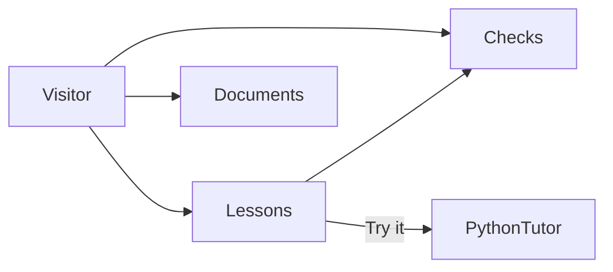
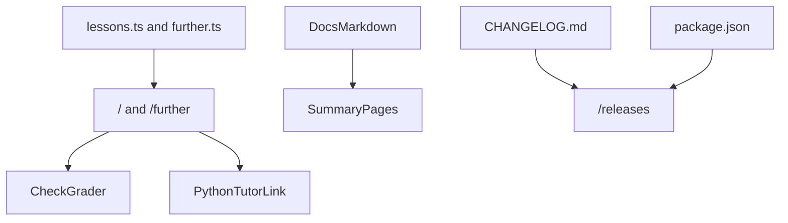
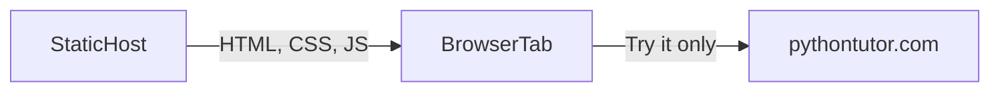

# Architecture and design

**Product:** Serpens

**Last updated:** 2026-10-15

## Summary

Serpens is a static Next.js site. The short path lives in `content/lessons.ts` and renders on `/`. The later lessons live in `content/further.ts` and render on `/further`. The browser compares a chosen answer with the lesson's answer and shows the explanation. Try it builds a link to Python Tutor and does not run anything here.

`/language` is a reading page: origins, comparisons, reasons to choose the language, and where it is used. `/vision` and `/architecture` read the Summary section of the two documents at build time. `/releases` renders `CHANGELOG.md`. The header chip reads the version from `package.json`.

Hosting is a static export. The files are served from the site root, so the build does not prefix assets. There is no database and no paid API. The pictures on the architecture page are the conceptual, logical, and physical views. The Mermaid diagrams later in this document are the same three views, and they change together.

## Conceptual

The visitor meets lessons, checks, and the living documents. A lesson can hand a program to Python Tutor. Python Tutor is outside this product. Checks are not.

Lessons are two pages. `/` holds thirteen programs, ordered from the top of a script through `None` and exceptions. `/further` holds eleven programs, from duck typing through async. Checks are questions about those programs. Documents are the vision, the architecture, and the release notes. `/language` is a reading page beside them, written in the page itself rather than in those files. Python Tutor runs a program only after the visitor chooses Try it.

## Logical

Lesson text, the documents, and the version are separate inputs. The two lesson pages are the ones that grade a check or build a Python Tutor link.

- `content/lessons.ts` holds the first page: the chapter, the explanation, the program, the notice, and the checks. `content/further.ts` holds the later lessons in the same shape. The answer id stays with the check. The page compares the chosen option with that id.
- `src/app/page.tsx` renders the short path. `src/app/further/page.tsx` renders the later lessons. Both use the same lesson view, the same grader, and the same Python Tutor link.
- `src/app/language/page.tsx` is the reading page on origins, comparisons, and use. It does not grade a check and it does not call Python Tutor.
- `src/lib/docs.ts` reads a file at build time and returns the body of `## Summary`. The vision and architecture pages render that body. They do not keep a second copy.
- `src/lib/playground.ts` builds `https://pythontutor.com/visualize.html` with `py=311` and the lesson program in the fragment. The code is percent-encoded. Omitting `mode=display` opens the editor, so the visitor sees the program before running it.
- `package.json` version is the header chip. `CHANGELOG.md` is the releases page.
- The three pictures on `/architecture` are SVG in `src/components/architecture/Diagrams.tsx`. They match these Mermaid diagrams.

## Physical

The host stores files. The browser grades checks. Execution happens on Python Tutor, and only after Try it.

- The export is static. Files are served from the site root, so the build leaves `BASE_PATH` empty and styles, scripts, and pictures load from `/`. A local build also leaves the path empty. The export contains the pages, the fonts, the python photograph, and the icon. It does not contain an interpreter.
- The browser downloads those files and grades checks in the tab. Answers are not sent to Serpens and are not stored.
- `pythontutor.com` receives the snippet when the visitor opens Try it. That request is the visitor's, to Python Tutor, not to a Serpens API. Python Tutor runs the snippet as Python 3.11. Its visualizer follows one flow, so the thread lessons name that limit beside the program.

## Visual system

The chrome matches AetherForge.

- Tokens in `src/app/globals.css`: ink `#152028`, muted `#5A6B76`, accent `#0F4C5C` / hover `#0C3D4A`, line `#D8C4AA`, paper `#F6EAD8`.
- Type: Source Serif 4, Source Sans 3, IBM Plex Mono, shipped as files under `src/app/fonts/` so a production build does not download them.
- Body: fixed `hero-bg.jpg`, a python. A light-brown wash (`#F6EAD8`) is stronger over the content column and lighter at the edges.
- Chrome: sticky header and footer use that light brown with a blur. Surfaces use `.panel`. Buttons are `.btn-accent` and `.btn-ghost`.
- The mark is a coiled python on a warm tan circle (`#E6CA98`), in the header and in `public/icon.svg`.
- The product name in the header is Serpens, with no subtitle.

## Decisions

| Decision | Choice | Why |
| --- | --- | --- |
| Site | Next.js static export | Zero cost. The Pages workflow can ship `out/` from the site root |
| Checks | Graded in the browser | No account and no round trip |
| Interpreter | Python Tutor | This site does not host a Python interpreter. Python Tutor accepts the program in the link |
| Version | Python 3.11 on Try it | The programs use Python 3.10 syntax, and Python Tutor runs 3.11 |
| Docs in the app | Summary section only | The page stays short. The file stays complete |
| Pictures | SVG on the page, Mermaid in this document | Both describe the same three views |
| Name | Serpens | The product name is that word alone |
| Visual system | AetherForge tokens and type | One family with the other rooms |
| Backdrop | A python | The animal the lessons are set against |

## Changelog

- 2026-10-15 — First room: static export, lessons, in-browser checks, Python Tutor links, three architecture views, and summary pages. The backdrop is a python.
